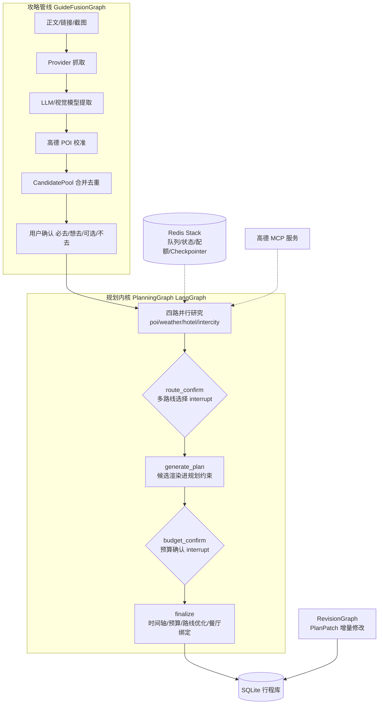

# TripMind 智能旅行规划助手 🌍✈️

> **衍生项目声明**：本项目衍生自 [jjyaoao/HelloAgents](https://github.com/jjyaoao/HelloAgents) 的旅行规划助手示例，并在其基础上大幅重构——原 HelloAgents 框架已替换为 LangGraph 编排 + 原生 OpenAI SDK，新增攻略智能导入、候选地点校准、interrupt 确认交互与 PlanPatch 增量修改等能力。感谢原作者的开源分享。

> 多 Agent 协作 + 攻略智能导入 + 对话式增量修改的旅行规划系统。
> 粘贴一篇小红书攻略或截图，AI 提取地点并到高德地图逐一核对位置；你确认"必去/不去"后，规划引擎生成带真实坐标、精细时间轴与确定性预算的逐日行程；之后还能用自然语言持续修改，只动该动的那一天。

## ✨ 核心特性

### 三种攻略输入，统一候选池
- **粘贴正文 / 公开链接 / 截图**三种导入方式（截图走视觉模型 `qwen3.8-omni-flash`，一次调用完成文字转写与地点提取）
- LLM 只负责提取地点与推荐理由，**坐标/名称一律回流高德 POI 校准**——查不到的地点明确标记"未确认位置"，绝不伪造坐标参与路线计算
- 跨攻略合并去重（poi_id 优先 + 名称包含归并，"鸡鸣寺/古鸡鸣寺"、"玄武湖/玄武湖景区"自动归并），来源可追溯
- 候选确认板：勾选框一键取舍（批量全选/按类筛选），进阶可调必去/想去/可选/不去四档优先级；云端聚合 + 本机覆盖，可删除攻略

### LangGraph 多 Agent 规划
- **四节点并行研究**（景点/天气/酒店/跨城交通 fan-out → reducer 合并 fan-in），单分支失败只降级对应数据
- 确定性日排程引擎：交通占时钟、三餐与景点用剩余时间、偏好出发时间、体力曲线与天气再平衡
- **interrupt 确认交互**：超预算时暂停询问"是否降级住宿"、可选"比较多个行程方向"（多路线选择），用户在前端决策卡片上选择后从 Checkpointer 断点续跑，已完成的研究不重算

### 对话式增量修改（PlanPatch）
- 自然语言指令 → LLM 翻译成结构化 Patch → **确定性代码应用与校验**（LLM 不直接改计划）
- 只修改受影响的天，其余天的 stable_id 原样保留；修改前展示差异，确认才生效
- 候选直取：新增/替换地点优先使用已校准的攻略候选，免高德二次查询

### 可信与可观测
- 确定性预算引擎（按人数/房间/晚数计算，不采用 LLM 汇总金额）、数据来源标记（实时/估算/缓存/生成）、降级明确提示
- SSE 实时进度推送（Agent 级状态与耗时、断线重连与事件续传）、任务队列配额限流
- 行程版本链（AI 修改/手动编辑/恢复历史均生成新版本）与执行模式（每日可勾选计划表）

### 沉浸式行程展示
- 行程页深色沉浸式设计：概览 Tab 以 Coverflow 封面轮播呈现全部景点（点击卡片直达对应行程日），配橙色高亮的日期区间与"出发前须知"贴士（规划收尾时基于完整行程生成，模型不可用时规则兜底）
- 锚点式分区导航（概览/预算/地图/每日行程/天气）随滚动自动高亮；地图路线按日着色 + 编号标记与行程卡片双向联动
- 支持导出图片 / PDF 与复制分享链接，历史版本随时可回滚

## 🧭 系统架构



职责分层：LLM 负责理解与组织（攻略提取/指令翻译/行程生成），地图工具负责外部事实，普通代码负责约束校验、金额计算、时间轴排程与结果验证。

## 🏗️ 技术栈

| 层 | 技术 |
|---|---|
| Agent 编排 | **LangGraph 0.6**（并行扇出/reducer/interrupt 断点恢复）+ langgraph-checkpoint-redis |
| LLM | 原生 OpenAI SDK · 阿里云 MaaS 专属端点，按模块分模型：主规划 `deepseek-v4.1-flash`、攻略提取 `qwen3.8-27b`、Patch 解析 `deepseek-v4.1-flash-1017`、截图 `qwen3.8-omni-flash`（视觉） |
| 地图数据 | 高德 MCP（官方 MCP SDK，stdio 会话池 ×4 并发轮询）：POI 检索/详情/天气/路线/餐厅 |
| 队列与状态 | **Redis Stack 双轨**（`REDIS_ENABLED` 一键切换内存模式）：Stream 任务队列、Hash 任务状态、WATCH 配额限流、重试 ZSET、死信队列、Checkpointer |
| 持久化 | SQLite（行程库 + 版本链 + 执行进度 + 攻略来源/事实），pydantic v2 全链路数据契约 |
| 后端 | Python 3.12 · FastAPI（SSE 流式进度） |
| 前端 | Vue 3 · TypeScript · Vite · Ant Design Vue · 高德 JS API · SSE（EventSource） |
| 测试 | unittest + mock + fakeredis + InMemorySaver，**168 个用例** |

## 📁 项目结构

```
helloagents-trip-planner/
├── backend/
│   ├── app/
│   │   ├── agents/             # 多 Agent 规划器（研究/生成/修复/回退）
│   │   ├── api/routes/         # trip(任务/SSE) / guide(攻略) / library(行程库) / map / poi
│   │   ├── graphs/             # planning_graph / revision_graph / guide_fusion_graph
│   │   ├── infrastructure/     # LLM 客户端(代理回退/分模型) / MCP 会话池 / redis_client
│   │   ├── models/             # schemas / candidate(候选契约) / patch / guide / geo
│   │   └── services/           # 候选池/攻略提取/Provider/存储/质量/时间轴/路线优化...
│   ├── tests/                  # 168 个测试（fakeredis/桩 Agent，显式内存模式）
│   └── evaluation/             # 离线评测器（JSONL 样本）
├── frontend/src/
│   ├── views/                  # Home / GuideImport / Result / MyTrips / TodayPlan
│   ├── components/             # CandidatePlaceBoard(候选确认) / RevisionDiff(差异确认)...
│   └── services/api.ts         # SSE 封装(断线重连/等待确认回调/取消)
```

## 🚀 快速开始

### 前提条件
- Python 3.12+、Node.js 16+
- 高德地图 API Key（Web 服务 + Web 端 JS API）
- LLM API Key（OpenAI 兼容端点）
- （可选）Docker：Redis Stack 用于任务队列与 interrupt 恢复；不装也可跑（见下）

### 后端

```bash
cd backend
python -m venv venv
venv\Scripts\activate            # Windows
pip install -r requirements.txt
cp .env.example .env             # 填入 LLM_*/AMAP_API_KEY 等密钥
uvicorn app.api.main:app --reload
```

**Redis 双轨**：`.env` 中 `REDIS_ENABLED=false`（默认）走纯内存任务队列，开箱即用；`true` 时需先启动 Redis（`docker run -d --name tripmind-redis -p 6379:6379 redis/redis-stack-server:latest`），可获得持久化队列、配额限流与 **interrupt 断点恢复**（预算确认/多路线选择交互依赖此模式）。

### 前端

```bash
cd frontend
npm install
npm run dev                      # PowerShell 若禁用 npm.ps1 用 npm.cmd run dev
# 打开 http://localhost:5173
```

### 推荐体验路径

1. 首页点"攻略导入" → 粘贴一篇攻略正文（或上传小红书截图）→ 确认候选地点的必去/不去 → "用这 N 个候选去规划行程"
2. 回首页（目的地已自动带入）填日期提交 → 进度中可见"将优先安排你确认的 N 个候选地点"
3. 勾选"比较多个方案"可体验生成前的方向选择卡片；超预算时会弹出降级确认卡片
4. 结果页"AI 修改行程"：如"第二天轻松一点"、"帮我加 XX"（在候选里的地点直接取用）

## 🧪 测试与验证

```powershell
# 后端（Windows PowerShell，显式内存模式）
cd backend
$env:REDIS_ENABLED = "false"; $env:PYTHONUTF8 = "1"; $env:PYTHONIOENCODING = "utf-8"
.\venv\Scripts\python.exe -m unittest discover tests   # 168 个用例

# 前端
cd frontend; npm.cmd run build                        # 含 vue-tsc 类型检查
```

覆盖：interrupt/恢复、并行扇出与单分支降级、Patch 链路与校验拒绝、候选合并去重/直取/截图提取、Redis 队列/配额/重试（fakeredis）、解析容错与注释剥离、时间轴与预算引擎等。

## 📄 API 概览

启动后访问 `http://localhost:8000/docs` 查看完整文档。主要端点：

| 端点 | 说明 |
|---|---|
| `POST /api/trip/jobs` | 创建异步规划任务（可携带候选地点与多路线开关） |
| `GET /api/trip/jobs/{id}/events` | SSE 订阅进度（Agent 状态/等待确认/完成） |
| `POST /api/trip/jobs/{id}/resume` | 对 interrupt 任务提交用户选择，断点续跑 |
| `POST /api/trip/revision-jobs` | 自然语言修改行程（PlanPatch 路径 + 差异确认） |
| `POST /api/guide-sources` | 攻略解析（正文/链接/截图 base64），返回校准后候选 |
| `GET /api/guide-sources/candidates` | 跨攻略聚合候选池（云端） |
| `DELETE /api/guide-sources/{id}` | 删除攻略及其候选与事实 |
| `GET/POST /api/library/trips...` | 行程库：版本链/恢复/执行进度/偏好 |

## ⚠️ 当前边界

- 跨城票价在未接入官方票务数据前为估算值（响应中 `is_estimated` 明确标记）
- 小红书等 JS 渲染页面**链接直读暂不支持**（识别后引导粘贴正文或截图导入）；Playwright 渲染 Provider 是后续项
- Patch 修改超范围（如换城市）时回退整份重生成，"只动一天"承诺在该路径不成立（差异确认会明确提示）
- 修改/生成的时间轴是地理直线距离排程，非真实道路导航
- 无用户系统（配额按客户端标识限流），单机部署；生产化需登录与多实例改造

## 🗺️ 后续路线（摘要）

多攻略事实冲突处理与图内候选确认 interrupt → 日编排管线拆解（容量/聚类/草稿/优化多步化）→ 平台路线模板库 → 预约提醒与出发前数据刷新 → 多城市行程。

## 📜 开源协议

CC BY-NC-SA 4.0

## 🙏 致谢

- [jjyaoao/HelloAgents](https://github.com/jjyaoao/HelloAgents) - 本项目衍生自其旅行规划助手示例（原框架已被替换，见顶部衍生声明）
- [LangGraph](https://github.com/langchain-ai/langgraph) - Agent 编排框架
- [高德地图开放平台](https://lbs.amap.com/) 与 [amap-mcp-server](https://github.com/sugarforever/amap-mcp-server)
- [Vue 3](https://vuejs.org/) / [Ant Design Vue](https://antdv.com/) / [FastAPI](https://fastapi.tiangolo.com/)

---

**TripMind** - 让旅行计划有依据，也有温度。
