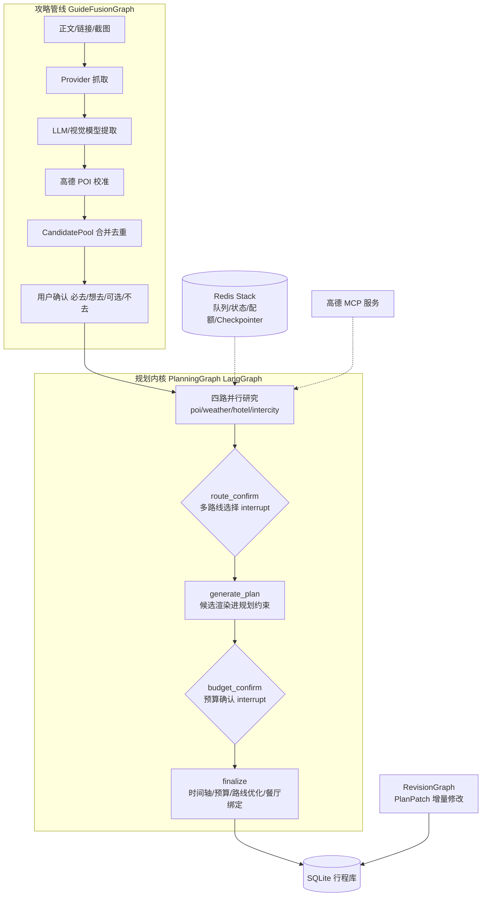

# TripMind 智能旅行规划助手 🌍✈️

> **衍生项目声明**：本项目衍生自 [jjyaoao/HelloAgents](https://github.com/jjyaoao/HelloAgents) 的旅行规划助手示例，并在其基础上大幅重构——原 HelloAgents 框架已替换为 LangGraph 编排 + 原生 OpenAI SDK，新增攻略智能导入、候选地点校准、interrupt 确认交互与 PlanPatch 增量修改等能力。感谢原作者的开源分享。

> 多 Agent 协作 + 攻略智能导入 + 对话式增量修改的旅行规划系统。
> 粘贴一篇小红书攻略或截图，AI 提取地点并到高德地图逐一核对位置；你确认"必去/不去"后，规划引擎生成带真实坐标、精细时间轴与确定性预算的逐日行程；之后还能用自然语言持续修改，只动该动的那一天。

## ✨ 核心特性

### 会话与长期偏好

- 历史对话按账号保存在SQLite，可从“历史对话”跨设备继续；需求摘要、关联任务、行程问答及待确认修改草稿均可恢复，模型只读取有限最近消息与当前摘要。
- “旅行偏好”支持主动保存、编辑、暂停、删除及按城市适用；当前需求优先，不自动学习敏感信息。
- 骨架默认使用精简直调，收尾建议默认规则生成，减少额外模型等待；实际提速幅度待联调测量。
- 结果页/今日计划支持刷新地图营业时间；预约政策仅在配置可信官方政策适配源后核验，未配置时仍明确待核实。

### 三种攻略输入，统一候选池
- **粘贴正文 / 公开链接 / 截图**三种导入方式（截图走视觉模型 `qwen3.8-omni-flash`，一次调用完成文字转写与地点提取）
- LLM 只负责提取地点与推荐理由，**坐标/名称一律回流高德 POI 校准**——查不到的地点明确标记"未确认位置"，绝不伪造坐标参与路线计算
- 跨攻略合并去重（poi_id 优先 + 名称包含归并，"鸡鸣寺/古鸡鸣寺"、"玄武湖/玄武湖景区"自动归并），来源可追溯
- 候选确认板：勾选框一键取舍（批量全选/按类筛选），进阶可调必去/想去/可选/不去四档优先级；云端聚合 + 本机覆盖，可删除攻略

### LangGraph 多 Agent 规划
- **四节点并行研究**（景点/天气/酒店/跨城交通 fan-out → reducer 合并 fan-in），单分支失败只降级对应数据
- 确定性日排程引擎：交通占时钟、三餐与景点用剩余时间、偏好出发时间、体力曲线与天气再平衡
- **interrupt 确认交互**：超预算时暂停询问"是否降级住宿"、可选"比较多个行程方向"（多路线选择），用户在前端决策卡片上选择后从 Checkpointer 断点续跑，已完成的研究不重算

### 对话式增量修改（PlanPatch）
- “我的行程”卡片提供“问这份行程 / 对话修改”独立入口：根据保存版本回答，展示计划字段依据和未知信息；问答不改行程。
- 结果页“行程对话”在本页打开侧边聊天面板，不跳转；快捷问题仅预填，发送后才调用模型。临时计划先保存以关联账号与行程。
- 明确点击建议后才生成修改草稿，展示差异与逐日安排，确认后保存新版本，并同步刷新本页景点、地图和费用。关闭再打开可恢复已同步的对话。对话提交与最终保存检查版本冲突；问答不查询实时票务或营业状态。
- 自然语言指令 → LLM 翻译成结构化 Patch → **确定性代码应用与校验**（LLM 不直接改计划）
- 只修改受影响的天，其余天的 stable_id 原样保留；修改前展示差异，确认才生效
- 候选直取：新增/替换地点优先使用已校准的攻略候选，免高德二次查询

### 可信与可观测

- 攻略中的预约、闭馆与避坑线索会进入景点详情和今日计划检查清单，支持展开来源引用；明确标注未经官方核验，未知不当作无需预约。地图开放时间可手动刷新，官方预约核验需另配可信政策源，未实现自动定时刷新。
- 确定性预算引擎（按人数/房间/晚数计算，不采用 LLM 汇总金额）、数据来源标记（实时/估算/缓存/生成）、降级明确提示
- SSE 实时进度推送（Agent 级状态与耗时、断线重连与事件续传）、任务队列配额限流
- 行程版本链（AI 修改/手动编辑/恢复历史均生成新版本）与执行模式（每日可勾选计划表）

对话规划进度按实际阶段显示耗时，可展开查看排队、查询、模型编排、地图核验、修复与收尾的明细；长时间等待时提示当前环节，不要求重复提交。任务 SSE 除进度事件外每 5 秒提供一次轻量状态快照，支持刷新后继续显示服务端累计时间。阶段计时用于定位瓶颈，并不代表模型生成已经提速。

### 行程展示与本页对话
- 顶部保留全部景点的 Coverflow 轮播，点击直达对应日期；结果页采用统一浅色整体面板，左半为景点小图/名称/顺序，右上地图、右下当前景点详情。
- 左侧标题通过前后箭头切天，首尾禁用；地图标记与景点选择联动，无常驻全程切天栏、无右侧独立滚动条。天气保留在每日行程内，不重复展示底部天气卡片。
- 费用明细内的交通、用餐与住宿独立按天切换，不影响景点日期；酒店信息合并为住宿参考文字，不再单列酒店卡片。收尾贴士默认由规则生成，可显式配置模型润色。
- 结果页侧栏复用原行程对话与修改确认流程，不自动应用草稿；原独立对话路由仍兼容历史入口。
- 支持导出图片 / PDF 与复制分享链接，历史版本随时可回滚

## 🧭 系统架构



职责分层：LLM 负责理解与组织（攻略提取/指令翻译/行程生成），地图工具负责外部事实，普通代码负责约束校验、金额计算、时间轴排程与结果验证。

## 🏗️ 技术栈

| 层 | 技术 |
|---|---|
| Agent 编排 | **LangGraph 0.6**（并行扇出/reducer/interrupt 断点恢复）+ langgraph-checkpoint-redis |
| LLM | 原生 OpenAI SDK · 阿里云 MaaS 专属端点，按模块分模型：主规划 `deepseek-v4.1-flash`、攻略提取 `qwen3.8-27b`、Patch 解析 `deepseek-v4.1-flash-1017`、截图 `qwen3.8-omni-flash`（视觉） |
| 地图数据 | 高德 MCP（官方 MCP SDK，stdio 会话池 ×4 并发轮询）：POI 检索/详情/天气/路线/餐厅 |
| 队列与状态 | **Redis Stack 双轨**（`REDIS_ENABLED` 一键切换内存模式）：Stream 任务队列、Hash 任务状态、WATCH 配额限流、重试 ZSET、死信队列、Checkpointer |
| 持久化 | SQLite（行程库 + 版本链 + 执行进度 + 攻略来源/事实），pydantic v2 全链路数据契约 |
| 后端 | Python 3.12 · FastAPI（SSE 流式进度） |
| 前端 | Vue 3 · TypeScript · Vite · Ant Design Vue · 高德 JS API · SSE（EventSource） |
| 测试 | unittest + mock + fakeredis + InMemorySaver；最近一次后端回归 **196项通过**，前端含构建、会话轻量测试和可选浏览器模拟检查 |

## 📁 项目结构

```
helloagents-trip-planner/
├── backend/
│   ├── app/
│   │   ├── agents/             # 多 Agent 规划器（研究/生成/修复/回退）
│   │   ├── api/routes/         # trip(任务/SSE) / guide(攻略) / library(行程库) / map / poi
│   │   ├── graphs/             # planning_graph / revision_graph / guide_fusion_graph
│   │   ├── infrastructure/     # LLM 客户端(代理回退/分模型) / MCP 会话池 / redis_client
│   │   ├── models/             # schemas / candidate(候选契约) / patch / guide / geo
│   │   └── services/           # 候选池/攻略提取/Provider/存储/质量/时间轴/路线优化...
│   ├── tests/                  # 后端回归（fakeredis/桩 Agent，显式内存模式）
│   └── evaluation/             # 离线评测器（JSONL 样本）
├── frontend/src/
│   ├── views/                  # ChatHome / Result / TripAssistant / 历史对话 / 偏好 / 登录与管理...
│   ├── styles/                 # result-journal.css（结果页主题）
│   ├── components/             # CandidatePlaceBoard(候选确认) / RevisionDiff(差异确认)...
│   └── services/api.ts         # SSE 封装(断线重连/等待确认回调/取消)
```

## 🚀 快速开始

### 前提条件
- Python 3.12+、Node.js 16+
- 高德地图 API Key（Web 服务 + Web 端 JS API）
- LLM API Key（OpenAI 兼容端点）
- （可选）Docker：Redis Stack 用于任务队列与 interrupt 恢复；不装也可跑（见下）

### 后端

```bash
cd backend
python -m venv venv
venv\Scripts\activate            # Windows
pip install -r requirements.txt
cp .env.example .env             # 填入 LLM_*/AMAP_API_KEY 等密钥
python -m app.services.auth_service create-admin --username admin  # 首次运行，交互输入管理员密码
python -m app.services.mcp_setup doctor
python -m app.services.mcp_setup prepare  # 显式安装固定地图工具并确认离线缓存
uvicorn app.api.main:app --reload
```

**Redis 双轨**：`.env` 中 `REDIS_ENABLED=false`（默认）走纯内存任务队列，开箱即用；`true` 时需先启动 Redis（`docker run -d --name tripmind-redis -p 6379:6379 redis/redis-stack-server:latest`），可获得持久化队列、配额限流与 **interrupt 断点恢复**（预算确认/多路线选择交互依赖此模式）。

### 前端

地图工具默认在启动时离线预热，普通规划不再联网安装依赖。环境/工具版本/镜像或缓存目录变更后需重新 prepare。`/health` 表示进程存活，`/health/ready` 表示规划依赖就绪；管理员可在管理中心查看状态并重新预热。

```bash
cd frontend
npm install
npm run dev                      # PowerShell 若禁用 npm.ps1 用 npm.cmd run dev
# 打开 http://localhost:5173
```

### 推荐体验路径

1. 使用管理员账号登录；其他用户在登录页注册普通账号，各自保存行程、攻略与偏好。
2. 首页直接输入旅行想法，例如“从武汉去威海玩四天”，在对话中补齐日期、偏好和预算后确认生成。
3. 也可先从“攻略导入”粘贴正文／链接／截图，确认候选地点后回到首页对话规划。
4. 在对话中说“比较几个方案”，可体验路线选择；超预算时在同一对话中确认是否调整。
5. 结果页点击“行程对话”在本页问答/生成修改草稿，确认后刷新当前计划；也保留“AI 修改行程”、历史版本和打卡。管理员通过导航“管理中心”查看记录归属。

### 账号与记录归属

- 管理员必须由部署者在终端创建，不会将第一个公开注册用户自动设为管理员。密码交互输入，数据库只保存加盐哈希。
- 首次创建管理员后，旧的无归属行程、攻略和共用偏好归入该账号，不删除已有行程或历史版本。
- 普通用户只能访问自己的记录；规划任务状态、SSE、断点恢复、行程版本和打卡也检查归属。管理员个人页面仍显示自己的数据，管理中心展示全部。
- 登录使用 HttpOnly Cookie；前端 API 请求和 EventSource 均携带凭证。HTTP 调试保持 `AUTH_COOKIE_SECURE=false`，HTTPS 部署设为 `true`。
- 前端与后端使用一致的主机名（例如都用 localhost，或都用服务器公网 IP），并把前端完整 Origin（含协议、端口）加入 `CORS_ORIGINS`。正式部署建议同域反向代理。
- 现有复制的行程链接受登录和归属检查保护，不再是匿名公开分享链接；独立的只读分享授权留待后续实现。
- POI 和图片等公共事实缓存可以跨用户复用，私人行程、攻略候选及对话草稿不会通过共享列表暴露。

### 会话摘要与结构化偏好（2026-11-04）

- 长对话使用“早期摘要 + 最近消息 + 当前需求/计划”。需求聊天保留最近16条消息，行程问答12条；首次积累4条更早消息时整理摘要，以后每积累6条更新一次。每次最多压缩24条、约1万字的资料，超长旧会话逐批追赶，不保证无限历史无损记忆。
- 摘要按此前表达、否定/排除、待确认问题组织，附用户原文依据，独立存在账号SQLite中；可展开“此前对话记忆”查看。模型压缩失败时使用原文摘录，不阻止正常回答；原始聊天不删除。摘要不是长期偏好，当前需求、最近要求及当前行程版本优先。
- 确认生成后，会话摘要同样作为本次行程的参考资料，创建任务时按账号重新读取，不接受客户端自行注入摘要。已有计划不因摘要更新而自动变化。
- 偏好分类为旅行节奏、出发作息、住宿、市内交通、兴趣、饮食和自由备注；支持城市范围及有效期。城市专属项优先于同项通用设置，到期不再召回，通用设置可重新生效。
- 同范围、同一结构化单值项冲突或重复时返回409，用户确认后暂停匹配的旧记录，不删除。兴趣/饮食按相同对象的偏好/避免处理；自由备注仅去重，不做任意自然语言语义冲突推断。修改期间冲突对象变化时需重新确认。
- 旧偏好新增列后保持自由备注，不擅自分类；本轮没有加入聊天自动保存偏好。生成/新修改请求与行程问答读取当前有效偏好，暂停/删除不会通过旧请求中的memory_context重新注入；已经出现在聊天正文或计划里的历史事实不会被追溯抹除。
- 更新后重启后端自动增列并创建conversation_summaries表，原会话/偏好保留；无需向量数据库或新密钥。摘要批次会额外调用现有对话模型，消耗少量额度，非每轮调用，模型超时失败改用摘录。

## 🧪 测试与验证

```powershell
# 后端（Windows PowerShell，显式内存模式）
cd backend
$env:REDIS_ENABLED = "false"; $env:PYTHONUTF8 = "1"; $env:PYTHONIOENCODING = "utf-8"
.\venv\Scripts\python.exe -m unittest discover -s tests

# 前端
cd frontend; npm.cmd run build                        # 含 vue-tsc 类型检查
node scripts/test-conversations.cjs                   # 无额外测试依赖
```

覆盖：interrupt/恢复、并行扇出与单分支降级、Patch 链路与校验拒绝、候选合并去重/直取/截图提取、Redis 队列/配额/重试（fakeredis）、解析容错与注释剥离、时间轴与预算引擎等。

可选浏览器检查：在独立终端启动 `npm run dev -- --host 127.0.0.1 --port 5175 --strictPort`，再运行 `node scripts/test-result-layout.cjs`。需可用 Playwright 包（可通过 NODE_PATH 指定）和已安装 Edge，未加入项目依赖。检查使用模拟账号、模型与地图接口，不产生真实业务数据；覆盖本页对话→草稿→确认后更新→关闭重开恢复、切天、编辑和手机布局，不能代替真实接口联调。

同一测试环境可运行 `node scripts/test-memory.cjs`，检查偏好保存/冲突确认、手机布局和摘要展示/恢复。后端 `tests/test_memory_upgrade.py` 使用临时数据库与模拟模型，覆盖迁移、有效期、冲突、隔离、摘要增量与失败回退，不写真实账号数据。

最近的本地真实两天规划图测试通过：完整流程约113秒；修正骨架输出额度后，复用研究资料的生成/收尾复测约46秒，含工具初始化。两次条件不同，不构成完整提速对照。`python -m scripts.check_live_plan` 会实际调用API并写测试Redis检查点/缓存，不是离线测试。

## 📄 API 概览

启动后访问 `http://localhost:8000/docs` 查看完整文档。主要端点：

| 端点 | 说明 |
|---|---|
| `POST /api/auth/register`、`POST /api/auth/login` | 普通用户注册与账号登录 |
| `GET /api/auth/me`、`POST /api/auth/logout` | 当前登录用户与退出 |
| `GET /api/admin/overview` | 管理员查看所有用户、行程、攻略及近期任务归属 |
| `POST /api/planner-chat/messages` | 聊天收集需求，确认后再创建规划任务 |
| `GET/PUT/DELETE /api/library/conversations...` | 账号会话列表、读写与删除，revision冲突保护 |
| `GET /api/library/memories`、`PUT/DELETE /api/library/memories/{id}` | 显式长期偏好的列表、创建/更新与删除 |
| `POST /api/library/trips/{id}/assistant/messages` | 基于保存版本问答和建议，不直接改计划 |
| `POST /api/library/trips/{id}/assistant/revision-jobs` | 根据明确建议生成修改草稿 |
| `POST /api/library/trips/{id}/refresh-advisories` | 手动刷新开放与已配置政策源提醒 |
| `POST /api/trip/jobs` | 创建异步规划任务（可携带候选地点与多路线开关） |
| `GET /api/trip/jobs/{id}/events` | SSE 订阅进度（Agent 状态/等待确认/完成） |
| `POST /api/trip/jobs/{id}/resume` | 对 interrupt 任务提交用户选择，断点续跑 |
| `POST /api/trip/revision-jobs` | 自然语言修改行程（PlanPatch 路径 + 差异确认） |
| `POST /api/guide-sources` | 攻略解析（正文/链接/截图 base64），返回校准后候选 |
| `GET /api/guide-sources/candidates` | 跨攻略聚合候选池（云端） |
| `DELETE /api/guide-sources/{id}` | 删除攻略及其候选与事实 |
| `GET/POST /api/library/trips...` | 行程库：版本链/恢复/执行进度/偏好 |

## ⚠️ 当前边界

### 任务生命周期与运行诊断（2026-11-05）

- 异步生成/修订使用可复用的独立执行进程。页面“取消生成”请求停止本地执行进程树，状态经过cancelling→cancelled；关闭页面仍只停止监听。已发给外部服务的请求可能继续计费，已完成任务不撤销，已保存版本不受影响。首次任务及取消后的新任务需要重新初始化子进程工具，后续正常任务复用进程。
- Redis Worker有唯一消费者标识、45秒租约、5秒心跳和60秒闲置待处理消息接管；状态写入检查租约，迟到结果不能覆盖取消或替代执行器。恢复优先使用规划检查点；未完成节点可能重做，修订图异常后从原始不可变草稿重新执行，不承诺外部API恰好调用一次。Redis≥6.2，接管机制参考[XAUTOCLAIM](https://redis.io/docs/latest/commands/xautoclaim/)。
- 发布任务时状态与Stream消息一起提交，重试消息转移与恢复确认原子执行；Idempotency-Key按账号与内容校验，24小时内同标识复用任务，不同内容返回409。前端保留未确认提交的标识用于网络重试；旧客户端无标识时提供60秒相同请求保护。独立标识表示新的提交，不是全局相同内容永久去重。
- 默认单次执行最长900秒（PLANNING_JOB_TIMEOUT_SECONDS），中断按现有退避重试处理。内存模式也支持进程取消，但重启不恢复任务；需要恢复能力请启用并持久化Redis。Redis已启用但不可达时拒绝提交，不静默降级到内存。
- 任务“运行详情”及管理员任务详情展示任务编号、模型/地图调用完成和失败数、缓存命中、重试/降级、当前未返回调用及接管次数。GET /api/trip/jobs/{id}/diagnostics沿用账号归属校验；HTTP返回X-Request-ID，提交日志将请求编号与任务编号关联。新增诊断日志只记录允许的元数据，不输出密钥、提示词、完整对话、工具参数或带Key的URL。
- 本轮完成代码编译、前端生产构建及少量本地运行检查：Windows进程隔离/取消、同提交复用、租约拒绝旧写入与待处理消息接管。没有执行大规模回归或故障压测，也未验证Linux部署环境。历史214项通过是上一轮结果，不代表此次修改后的全量回归。

- 跨城票价在未接入官方票务数据前为估算值（响应中 `is_estimated` 明确标记）
- 小红书等 JS 渲染页面**链接直读暂不支持**（识别后引导粘贴正文或截图导入）；Playwright 渲染 Provider 是后续项
- Patch 修改超范围（如换城市）时回退整份重生成，"只动一天"承诺在该路径不成立（差异确认会明确提示）
- 新生成/修改的时间轴会逐段查询高德道路距离和预计耗时（景点间及酒店接驳），失败/缺坐标/达到查询额度时明确回退估算；访问顺序和地图连线仍是坐标示意，不代表道路导航。公共交通按人数、驾车按每4人一车计参考费用；车站接驳尚未定位时按15元/人/段预留，机场实际费用可能远高于此，餐厅绕行尚未计入。
- 已实现用户账号与记录隔离，仍为单机部署；多实例、密码找回和独立只读分享尚未实现
- 未配置真实官方预约政策供应源；后台自动定时刷新、逐字/逐日内容流式输出仍待实现。取消与Redis异常接管见上节边界，内存模式不提供重启恢复。
- 前端浏览器检查使用模拟API；真实浏览器→HTTP Worker→模型地图→保存恢复与多账号操作仍需完整验收。仓库代码更新不代表已部署到服务器。

## 🗺️ 后续路线（摘要）

- 持续完善数据库并发一致性、PostgreSQL迁移准备、容量基线与生产部署。
- 当前已有共享缓存、上游保护、有限排队、请求诊断及核心写入版本校验；新缓存默认关闭，付费供应源、服务器部署和生产容量尚未完整验收，不承诺无限并发。
- 私人计划、设计记录与部署交接文档不随公开仓库提交。

### 2026-11-04 路线与预算准确度

- 高德Web服务路径规划复用 `AMAP_API_KEY`，不需新增模型。`ROAD_ROUTES_ENABLED=true`；每次构建默认最多24次查询，12秒后不发起新查询，单请求网络各阶段最多2秒。可关闭道路查询，明确使用估算。
- 成功路线按方向/城市/日期/出发半小时段/交通方式缓存15分钟（进程内，最多512条）；查询失败不缓存为真实数据。步行、公交/地铁和驾车分别处理，公交返回票价仍是参考，不是购票报价。
- 费用区展示逐段距离、耗时和来源；预算汇总时间轴中的路段，不再对已有路段数据的日期机械使用50元/人/天。旧日期无路段数据时保留原预留口径；餐饮/酒店/门票仍非实时价格。未排入时间轴的景点不收门票预算。
- 修正修改行程时往返跨城参考价重复乘二的问题，局部修改重建受影响日期并在时间轴重建后算预算。旧计划不会在打开时自动产生收费查询，需生成新计划或修改后保存。
- 实际调用高德步行与公交接口成功，距离/耗时及公交票价可解析；不代表已完成真实浏览器全链路验收。路径规划接口说明：[高德官方文档](https://lbs.amap.com/api/webservice/guide/api/direction)。

多攻略事实冲突处理与图内候选确认 interrupt → 日编排管线拆解（容量/聚类/草稿/优化多步化）→ 平台路线模板库 → 预约提醒与出发前数据刷新 → 多城市行程。

## 📜 开源协议

CC BY-NC-SA 4.0

## 🙏 致谢

- [jjyaoao/HelloAgents](https://github.com/jjyaoao/HelloAgents) - 本项目衍生自其旅行规划助手示例（原框架已被替换，见顶部衍生声明）
- [LangGraph](https://github.com/langchain-ai/langgraph) - Agent 编排框架
- [高德地图开放平台](https://lbs.amap.com/) 与 [amap-mcp-server](https://github.com/sugarforever/amap-mcp-server)
- [Vue 3](https://vuejs.org/) / [Ant Design Vue](https://antdv.com/) / [FastAPI](https://fastapi.tiangolo.com/)

---

**TripMind** - 让旅行计划有依据，也有温度。
